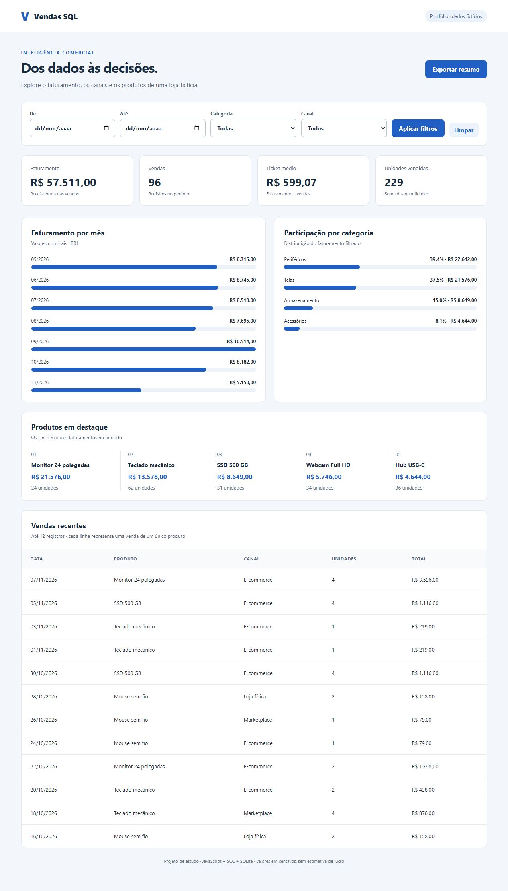

# Vendas SQL

Painel de análise de vendas com importação de CSV, consultas SQL e interface responsiva em JavaScript. Projeto educacional de portfólio de Erick Augusto, construído com apoio de IA e documentado para estudo e personalização.



## Perguntas que o painel responde

- Quanto a loja fictícia faturou no período?
- Qual foi o ticket médio por venda?
- Quais categorias e produtos concentraram o faturamento?
- Como o faturamento se distribuiu entre os meses e canais?

Apresentação curta de produto e interface: acesse `/projeto` com o servidor em execução.

## Executar

Requisito: **Node.js 22.13 ou superior**, sem dependências externas. Testado localmente com Node 22.15. O módulo SQLite pode emitir um aviso de recurso experimental nessa versão.

```bash
git clone https://github.com/AugstConsagrado/vendas-sql.git
cd vendas-sql
npm start
```

Abra **http://127.0.0.1:3001**. A primeira execução importa `data/vendas-exemplo.csv`: **96 vendas inteiramente fictícias**, entre maio e novembro de 2026, para demonstrar o sistema. São dados sintéticos, não uma pesquisa de mercado nem resultados de uma empresa real.

## Funcionalidades implementadas

- Filtros combinados de período, categoria e canal.
- Faturamento, vendas, ticket médio e unidades vendidas.
- Faturamento mensal, participação de categorias e cinco principais produtos.
- Até 12 vendas recentes da seleção.
- Exportação do resumo filtrado em JSON.
- Importação local de CSV com validação e substituição transacional da base.
- Estados vazios e mensagens para períodos inválidos.

## Modelo dos dados e fórmulas

Cada linha representa **uma venda de um único produto**, não um item de um carrinho com vários produtos. Por isso, `COUNT(*)` representa o número de vendas nesta versão.

| Indicador | Cálculo |
|---|---|
| Faturamento | `SUM(quantity * unit_price_cents)` |
| Vendas | `COUNT(*)` |
| Unidades | `SUM(quantity)` |
| Ticket médio | faturamento ÷ vendas, arredondado ao centavo |
| Participação | faturamento da categoria ÷ faturamento filtrado |

Preços são armazenados como inteiros em **centavos**, evitando erros de ponto flutuante nas somas. Uma quantidade 2 e um preço 7900 representam R$ 158,00 de faturamento. Não há cálculo de lucro: custos, impostos, devoluções e descontos não fazem parte da base.

## Importar outra base de demonstração

Pare o servidor antes de substituir a base. Mantenha os nomes e a ordem das colunas e use UTF-8, vírgula como separador e datas no formato AAAA-MM-DD (não há separador decimal no preço):

```csv
date,product,category,channel,quantity,unit_price_cents
2026-06-01,Mouse sem fio,Periféricos,Online,2,7900
2026-06-02,"Kit teclado, mouse",Periféricos,Loja,1,15900
```

As datas seguem `AAAA-MM-DD`. Campos com vírgulas devem estar entre aspas. O importador suporta BOM UTF-8, CRLF, aspas escapadas e quebras de linha dentro de campos entre aspas. Quantidades: 1 a 1000; preços: 1 a 1000000 centavos; textos: 1 a 100 caracteres; máximo de 100000 registros. Todos os registros são validados antes de qualquer substituição.

```bash
npm run import -- data/vendas-exemplo.csv --replace
npm start
```

Sem `--replace`, o importador recusa alterar uma base já preenchida. A substituição é intencional e não preserva a base anterior; faça uma cópia do seu banco se precisar mantê-lo.

## Testes e arquitetura

```bash
npm test
```

Os testes verificam somas em centavos, média, filtros combinados, seleção vazia, datas inválidas, parsing de CSV, preservação da base em importações inválidas e respostas HTTP. Os testes utilizam bases isoladas. Há um workflow de GitHub Actions para executar a suíte.

```text
data/vendas-exemplo.csv  base sintética versionada
src/analytics.js        leitura de CSV, validação e agregações SQL
src/import.js           importação pela linha de comando
src/server.js           servidor e API somente de leitura
public/                 HTML, CSS e JavaScript da interface
test/                   testes unitários e de integração
docs/                   imagem e roteiro de estudo
```

O banco `data/sales.db` é gerado localmente e ignorado pelo Git. As consultas usam parâmetros, inclusive nos filtros. A API `GET /api/dashboard` aceita `from`, `to`, `category` e `channel` e retorna totais, agregações, opções e vendas recentes. Os filtros de data são inclusivos. O servidor atende apenas em `127.0.0.1`.

## Limites e próximos passos

Este painel é local e não tem login, integração com ERP, pedidos com múltiplos produtos, comparação com período anterior ou previsão por IA. Meses sem vendas não aparecem nas barras. Próximos exercícios: implementar comparação mensal, adicionar devoluções, criar migrações e automatizar testes de interface. Esses itens são propostas, não recursos já entregues.

Veja [o roteiro de estudo](docs/ESTUDO.md) para transformar o exemplo em aprendizado demonstrável.

